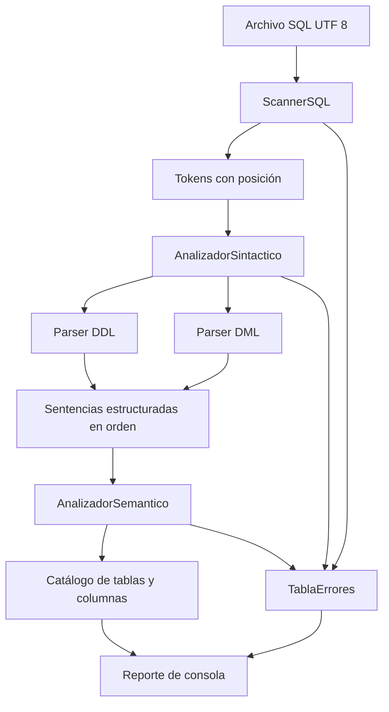
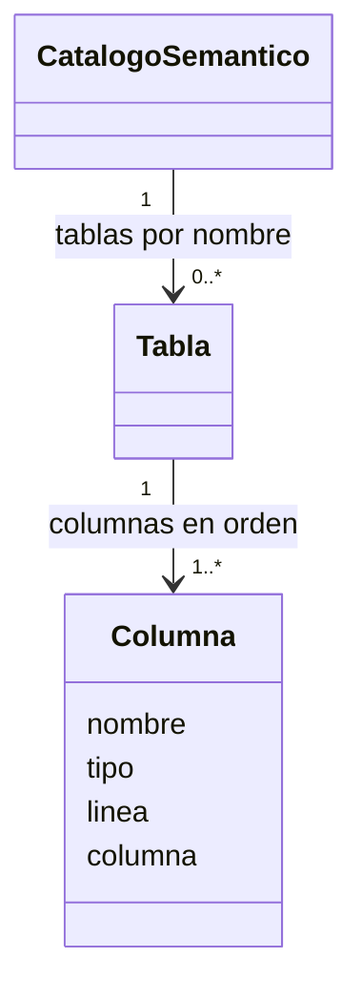
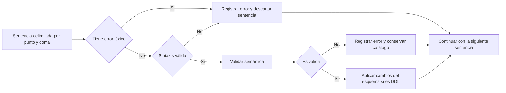

# Fase 2 del compilador SQL

El proyecto analiza scripts DDL y DML en español con Java 21 o posterior.
El scanner separa tokens; el parser comprueba la gramática y construye
sentencias; la semántica valida nombres, ámbitos y tipos. Se conserva la fase
léxica original y se añade un catálogo semántico con las declaraciones válidas.

## Arquitectura



`CompiladorSQL.analizar(String)` devuelve un `ResultadoCompilacion` con
tokens, símbolos léxicos, sentencias reconocidas, catálogo semántico, errores
unificados y cantidad de sentencias válidas. Cada llamada crea un catálogo
vacío. `Main archivo.sql --fase2` utiliza este flujo; sin la opción conserva
el modo léxico de fase 1. `--resumen` omite únicamente tokens y tabla léxica
del reporte, sin cambiar las validaciones.

## Gramática del lenguaje

```text
programa    ::= (sentencia ';')* EOF
sentencia   ::= crear | alterar | eliminar | truncar | renombrar
              | seleccionar | insertar | actualizar | borrar
crear       ::= CREAR TABLA id '(' columna (',' columna)* ')'
columna     ::= id tipo
tipo        ::= ENTERO | TEXTO | FECHA | DECIMAL | BOOLEANO
alterar     ::= ALTERAR TABLA id (AGREGAR columna | MODIFICAR columna | QUITAR id)
eliminar    ::= ELIMINAR TABLA id
truncar     ::= TRUNCAR TABLA id
renombrar   ::= RENOMBRAR TABLA id A id
seleccionar ::= SELECCIONAR ('*' | lista_ids) DESDE id [DONDE condicion]
insertar    ::= INSERTAR EN id ['(' lista_ids ')'] VALORES '(' lista_valores ')'
actualizar  ::= ACTUALIZAR id ASIGNAR asignacion (',' asignacion)* [DONDE condicion]
asignacion  ::= id '=' valor
borrar      ::= BORRAR DESDE id [DONDE condicion]
lista_ids   ::= id (',' id)*
lista_valores ::= valor (',' valor)*
valor       ::= entero | decimal | cadena | VERDADERO | FALSO
condicion   ::= conjuncion (O conjuncion)*
conjuncion  ::= negacion (Y negacion)*
negacion    ::= NO negacion | '(' condicion ')' | comparacion
comparacion ::= operando relacional operando
operando    ::= id | valor
relacional  ::= '=' | '!=' | '<>' | '<' | '>' | '<=' | '>='
```

`id` usa la regla de identificadores de fase 1. Nombres y palabras de la
gramática se comparan sin distinguir mayúsculas. No se admiten listas vacías,
comas finales ni sentencias sin punto y coma. Las comparaciones tienen prioridad
sobre `NO`, seguido de `Y` y finalmente `O`; los paréntesis cambian el
agrupamiento. El árbol conserva operandos, operadores y posiciones originales.

`AGREGAR`, `MODIFICAR`, `QUITAR` y `A` son palabras de contexto que
el parser reconoce en DDL, sin cambiar el catálogo del scanner. `VERDADERO`
y `FALSO` se interpretan como booleanos cuando ocupan una posición de valor
u operando; evite utilizarlos como nombres de columnas. La notación interna
`tabla.columna` expresa el ámbito y no agrega acceso con punto al SQL de entrada.

## Catálogo y análisis semántico



La tabla léxica registra los identificadores observados. El catálogo semántico
registra solo tablas declaradas correctamente y sus columnas con tipo,
categoría, ámbito y posición. Por ejemplo, `usuarios.id` y `productos.id`
son columnas distintas. La columna mantiene su primera posición al modificar
su tipo; renombrar una tabla actualiza el ámbito conservando sus declaraciones.

Las sentencias se validan en orden. `CREAR` rechaza tablas y columnas
duplicadas. `ALTERAR` agrega columnas nuevas, modifica tipos de columnas
existentes o quita columnas existentes; quitar la última columna es un error.
`RENOMBRAR` exige un nombre nuevo libre. `ELIMINAR` retira el esquema;
`TRUNCAR` comprueba la existencia y conserva sus columnas.
Un DDL inválido no aplica cambios parciales.

DDL y DML exigen tablas existentes. `SELECCIONAR` valida proyección y
condiciones; `INSERTAR` valida columnas, duplicados, cantidad y tipos de
valores. Sin lista de columnas, los valores siguen el orden de declaración;
con lista explícita se validan las columnas indicadas. No se requieren valores
para las columnas omitidas porque en esta fase no se almacenan filas ni se
modelan restricciones de nulidad. `ACTUALIZAR` valida columnas, tipos y
asignaciones repetidas; `BORRAR` valida tabla y condición.

| Tipo declarado | Valor admitido |
|---|---|
| ENTERO | Literal entero, por ejemplo `12` |
| DECIMAL | Entero o decimal, por ejemplo `12` o `12.50` |
| TEXTO | Cadena entre comillas simples |
| FECHA | Cadena ISO `'AAAA-MM-DD'` con fecha de calendario válida |
| BOOLEANO | `VERDADERO` o `FALSO`, sin comillas |

En condiciones se pueden comparar tipos iguales o dos tipos numéricos.
Una cadena comparada con FECHA debe contener una fecha válida. TEXTO y BOOLEANO solo
admiten `=`, `!=` y `<>`. Las comparaciones ordenadas permiten números y fechas.
Los enteros/decimales se validan como literales
del lenguaje, sin imponer rangos de almacenamiento de un motor de base de datos.

## Tabla de errores y recuperación

Cada diagnóstico tiene fase, código, mensaje, lexema, línea y columna.
El reporte se ordena por posición y muestra los totales por fase.

| Código | Significado |
|---|---|
| LEX-001 | Token no reconocido por el scanner |
| SYN-000 | Inicio distinto de DDL o DML |
| SYN-001 a SYN-009 | Estructura DDL incompleta o incorrecta |
| SYN-010 | Coma ausente entre definiciones de columnas |
| SYN-101 a SYN-109 | Estructura DML o condición incompleta o incorrecta |
| SYN-110 | Coma ausente en columnas, valores o asignaciones |
| SEM-001 | Tabla existente o destino de renombrado ocupado |
| SEM-002 | Columna duplicada |
| SEM-003 | Tabla inexistente |
| SEM-004 | Columna inexistente en su tabla |
| SEM-005 | Columna repetida en inserción o asignación |
| SEM-006 | Cantidad de valores incorrecta |
| SEM-007 | Valor incompatible con el tipo declarado |
| SEM-008 | Comparación de tipos u operador incompatibles |
| SEM-009 | Intento de quitar la última columna |



Los módulos de parser usan `CursorTokens`. El dispatcher delimita sentencias
por `;`, elige DDL o DML y mantiene el orden; cada módulo aplica las reglas
de su gramática con ese contrato de cursor. Una sentencia con error léxico o
sintáctico no llega a semántica. Si falta un `;`, se descarta hasta el
siguiente delimitador, por lo que también puede perderse la sentencia
inmediatamente posterior. Una cadena sin cerrar consume hasta EOF según el
contrato léxico de fase 1.

## Alcance y comprobación

La fase 2 comprueba scripts y mantiene esquemas. No ejecuta consultas, no
almacena registros y no conecta con un motor SQL. La interfaz gráfica y la
ejecución corresponden a fase 3. Tampoco se incorporan JOIN, alias, claves,
restricciones, escapes de comillas ni operaciones aritméticas.

Las suites `PruebaTablaSimbolos`, `PruebaFase1`, `PruebaParserDDL` y
`PruebaFase2` comprueban léxico, gramática, tipos, ámbitos, cambios de esquema,
atomicidad, recuperación y códigos de salida reales de Main.
La compilación usa `--release 21 -Xlint:all -Werror`. Consulte
[el instructivo de demostración](instructivo_demostracion.md) para ejecutar
todo desde un menú.
