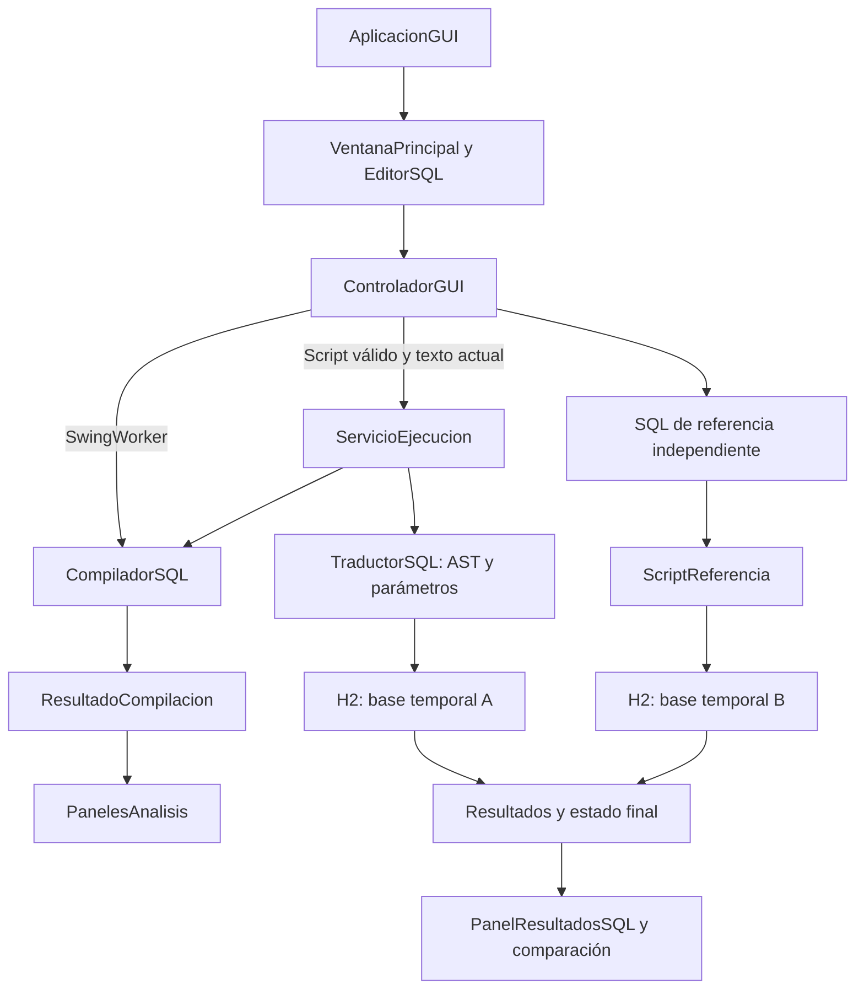

# Fase 3 — Interfaz gráfica y ejecución SQL

> **Actualización: almacenamiento permanente.** La interfaz guarda ahora tablas y filas en la carpeta del usuario `SQLStudio/datos`. Analizar y Limpiar conservan los datos. Comparar SQL y las pruebas siguen usando bases temporales. Consulta [persistencia y ejemplo entre sesiones](persistencia.md); las indicaciones anteriores sobre una base nueva en cada ejecución normal ya no aplican.

La fase 3 añade una aplicación de escritorio **Java 21 con Swing y tema FlatLaf 3.6.2** al compilador en español. FlatLaf mejora el aspecto de los componentes Swing; la interfaz sigue usando la misma tecnología Java. Se reutilizan scanner, parser, semántica y resultados de la fase 2; se incorporan traducción del árbol sintáctico, ejecución real sobre **H2 2.4.240** y comparación con SQL escrito por separado.

## Requisitos del enunciado e implementación

| Requisito obligatorio | Implementación y evidencia reproducible |
|---|---|
| Interfaz de entrada de cadenas | `EditorSQL` en `VentanaPrincipal`: entrada editable, numeración, resaltado y apertura de `.sql` UTF-8. |
| Mostrar lexemas, tokens y elementos del análisis | `PanelesAnalisis`: Tokens con posición, esquema declarado e identificadores léxicos separados. |
| Mostrar errores | Tabla con fase, código, mensaje, lexema y posición; seleccionar un error ubica el cursor. Incluye errores de ejecución del motor. |
| Validación de scripts | `CompiladorSQL.analizar` ejecuta las tres etapas; un script inválido no se ejecuta. Editar invalida el análisis anterior. |
| Ejecución de scripts frente a ejecución SQL | `ServicioEjecucion` ejecuta el AST traducido; `comparar` ejecuta un SQL equivalente en otra base y contrasta consultas y estado final. |
| Documentación y diagramas por fase | Este documento, la guía del integrante 1, documentación previa, ejemplos y suites de pruebas. |

La interfaz visual, los atajos, la paleta y el motor H2 son decisiones de implementación; el enunciado no exige una biblioteca gráfica ni un motor específico. La fecha publicada es **24/10/2026**. La rúbrica separa funcionamiento, documentación y explicación: **50 %, 20 % y 30 %**, respectivamente.

## Arquitectura



`AplicacionGUI` inicia Swing en su hilo gráfico. `VentanaPrincipal` compone controles y vistas. `ControladorGUI` conserva el análisis y el texto al que pertenece, habilita acciones y coordina operaciones. `Estilo` instala el tema FlatLaf y centraliza el aspecto. Los paneles presentan los objetos recibidos; no contienen otro compilador ni conexiones JDBC.

El análisis y la ejecución se realizan en `SwingWorker.doInBackground()`. `done()` recibe el resultado y actualiza controles. Durante una operación se deshabilitan acciones simultáneas y edición. Al cerrar la ventana, el controlador deja de actualizarla; las operaciones en curso cierran sus conexiones al terminar.

## Contrato de análisis y ejecución

1. El editor entrega un `String` a `CompiladorSQL.analizar`.
2. `ResultadoCompilacion` contiene tokens, identificadores observados, sentencias, catálogo semántico, diagnósticos y cantidad de sentencias válidas.
3. Ejecutar exige análisis válido y coincidencia exacta con el texto actual. Cualquier modificación invalida ese resultado.
4. El servicio **vuelve a analizar** antes de abrir la base. Si hay errores léxicos, sintácticos o semánticos, no ejecuta ninguna sentencia.
5. El traductor recorre las sentencias en su orden original. El **catálogo final no se utiliza como sustituto de la ejecución**: crear, alterar, renombrar, truncar y eliminar tienen efectos reales en cada paso.
6. Cada llamada de ejecución crea una base privada y nueva en memoria y la cierra al terminar. El script debe incluir sus declaraciones. No existe persistencia entre clics ni conexión a una base externa.
7. Ante un fallo del motor se registra el mensaje y la posición de la sentencia y se detiene el resto del script. Se conservan en el informe los resultados anteriores; no se promete una transacción atómica de todo el script. La base temporal se descarta después.

`InformeEjecucion` reúne análisis, resultados por sentencia y duración. Cada `ResultadoEjecucion` conserva número, comando, posición, SQL generado, columnas, filas, cantidad afectada y posible error. Los valores SQL nulos se conservan y se muestran como `NULL`.

## Traducción y tipos de almacenamiento

La traducción usa `SentenciaDDL`, `SentenciaDML` y `CondicionSQL`. No reemplaza palabras dentro del texto: por ejemplo, `'SELECCIONAR; BORRAR'` sigue siendo un literal. Los nombres se normalizan sin distinguir mayúsculas y se citan como identificadores. Los valores se envían mediante parámetros de `PreparedStatement`.

| Tipo del lenguaje | Tipo generado en H2 | Tratamiento |
|---|---|---|
| ENTERO | `NUMERIC(1000,0)` | Parámetro `BigDecimal`; hasta la precisión admitida por el tipo del motor. |
| DECIMAL | `DECFLOAT(1000)` | Parámetro `BigDecimal`; se evita convertir números a `double`. |
| TEXTO | `CHARACTER VARYING` | Cadenas como parámetros; apóstrofes y palabras SQL no alteran la consulta. |
| FECHA | `DATE` | El compilador valida formato ISO y fecha de calendario; H2 almacena la fecha. |
| BOOLEANO | `BOOLEAN` | `VERDADERO`/`FALSO` se convierten en valores booleanos. |

H2 impone límites y reglas de conversión de almacenamiento. Una modificación de tipo sobre datos incompatibles puede fallar aunque su estructura sea válida; ese caso se informa como error de ejecución. Las columnas omitidas de una inserción pueden quedar en `NULL`, pues el lenguaje no modela restricciones de nulidad.

Se mantienen los nueve comandos, cinco tipos y condiciones `Y`, `O`, `NO` de la gramática documentada en [fase 2](fase2.md). No se presenta como una implementación de todo SQL: no incorpora JOIN, subconsultas, claves, funciones o transacciones del lenguaje.

## Comparación con una referencia independiente

La pestaña **SQL de referencia** recibe un equivalente escrito en SQL. No se toma el SQL generado como su propia respuesta esperada. `ServicioEjecucion.comparar` usa dos bases nuevas: una para la traducción y otra para la referencia.

Se contrastan:

- Cantidad de consultas y nombres/orden de sus columnas.
- Filas de cada consulta como conjuntos con repeticiones: el orden de filas no importa y los duplicados sí cuentan.
- Esquema final: tablas, columnas y familias de tipos.
- Datos finales de todas las tablas, aunque no haya consultas explícitas.

Los números se normalizan para que `1.20` y `1.2` se comparen por su valor. También se normalizan fechas y mayúsculas de nombres. La comparación no prueba equivalencia para todos los datos posibles: verifica las ejecuciones concretas. No exige la misma precisión declarada, restricciones ni secuencia de cantidades afectadas cuando las consultas y el estado final coinciden.

La referencia admite únicamente DDL/DML básico sobre tablas: `CREATE`, `ALTER`, `DROP`, `TRUNCATE`, `INSERT VALUES`, `SELECT`, `UPDATE` y `DELETE`, con `ORDER BY` básico en consultas. El delimitador respeta cadenas, identificadores citados y comentarios. Una referencia vacía, sin `;`, con errores o fuera de ese alcance no aprueba la comparación. No se admiten comandos de archivos, alias de funciones ni consultas externas.

## Preparación y arranque

1. Tener un **JDK 21 o posterior** con `java` y `javac` disponibles.
2. Conservar `lib/h2-2.4.240.jar` y `lib/flatlaf-3.6.2.jar`, incluidos con el proyecto. El primero es el motor SQL y el segundo el tema visual de Swing. No hace falta instalar ni iniciar un servidor H2.
3. Conservar la carpeta completa. Los lanzadores y ejemplos resuelven su ubicación
   aunque la terminal esté en otra carpeta.
4. Abrir **ABRIR_GUI.cmd**. Para verificar, usar **VERIFICAR_FASE3.cmd**.
   En VS Code, abrir **ABRIR_EN_VSCODE.cmd** y usar **SQL Studio - Interfaz grafica → F5**.

También se puede iniciar desde PowerShell:

```powershell
powershell -NoProfile -ExecutionPolicy Bypass -File .\gui.ps1 -Modo gui
powershell -NoProfile -ExecutionPolicy Bypass -File .\gui.ps1 -Modo pruebas
powershell -NoProfile -ExecutionPolicy Bypass -File .\gui.ps1 -Modo demo
powershell -NoProfile -ExecutionPolicy Bypass -File .\gui.ps1 -Modo capturas
powershell -NoProfile -ExecutionPolicy Bypass -File .\gui.ps1 -Modo empaquetar
```

El motor y el tema visual están fijados a las versiones incluidas; la demostración no requiere descargar dependencias ni acceder a Internet. Las capturas requieren un escritorio gráfico. En un entorno sin escritorio se deben ejecutar pruebas de lógica en lugar de abrir la ventana.

El modo `empaquetar` genera `output/SQLStudio/ABRIR.cmd`, un JAR con sus
dependencias y ejemplos para presentar sin IDE. `Main` sin argumentos abre la GUI;
con `--ayuda` muestra el uso y con un archivo conserva el modo de consola.

La prueba de VS Code utiliza la API oficial del depurador en una instancia
separada. Conserva la tarea de compilación, entrada y classpath de F5; cambia la
consola a `internalConsole` para capturar la salida. Verifica compilación previa
con código 0, confirmación funcional y terminación de ambas entradas. El adaptador
Java instalado no emite un código de salida de la aplicación: el informe lo
conserva como `null` y lo indica expresamente. El JAR y `Main` se verifican además
como procesos normales con código de salida 0.

Para Windows también se preparó `output/Escritorio/SQLStudio/SQLStudio.exe`:
`jpackage` incluye el entorno Java dentro de esa carpeta. No requiere instalar
Java en el equipo receptor. Debe copiarse la carpeta completa, no solo el `.exe`.
El JAR conserva la compatibilidad con Java 21; la aplicación autónoma local
incluye el entorno del JDK 25 utilizado para empaquetarla.

El modo de consola anterior se conserva:

```powershell
powershell -NoProfile -ExecutionPolicy Bypass -File .\demo.ps1 -Modo todo
java -cp out Main tests/demo_fase2_valido.sql --fase2 --resumen
```

`Main` continúa siendo la entrada CLI; `ui.AplicacionGUI` es la entrada gráfica. Para llamadas manuales, el classpath de Windows debe incluir `out;lib/*`, que incorpora los dos archivos JAR.

## Demostración y verificación

`tests/demo_fase3.sql` contiene **19 sentencias** con los nueve comandos y los cinco tipos. `tests/demo_fase3_referencia.sql` contiene el equivalente para la comparación. El ejemplo muestra inserciones, consultas, actualización, cambios de esquema, renombrado, borrado, truncado y eliminación. La última consulta queda vacía tras `TRUNCAR`; deben inspeccionarse las anteriores para explicar los datos.

Secuencia recomendada: **Ejemplo completo → Analizar → inspeccionar Tokens/Símbolos → Ejecutar → seleccionar consultas → Comparar SQL → Ejemplo con errores → Analizar y seleccionar un error**. Demostrar también que editar bloquea Ejecutar y que una referencia con valores diferentes produce diferencias.

Las pruebas deben cubrir las suites anteriores, ejecución real, tipos, literales, condiciones, aislamiento entre ejecuciones, bloqueo de scripts inválidos, errores del motor, comparación positiva y negativa, y comportamiento de la interfaz. La cantidad final y el resultado de las comprobaciones se reportan después de ejecutarlas; añadir archivos no demuestra que todas pasen.

La [guía del integrante 1](guia_integrante1.md) detalla la ruta de aprendizaje, las pruebas manuales y el ensayo de exposición. Cada integrante documenta y explica su contribución. La preparación busca evidencias de funcionamiento y una explicación completa; la calificación corresponde al docente.
