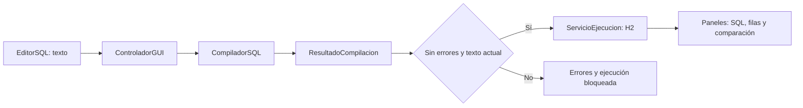

# Tu guía: integrante 1 — interfaz y coordinación

Tu parte es comprender, mantener y explicar la ventana del compilador. **La base gráfica ya está implementada:** comienza usándola y leyendo sus archivos; no necesitas reconstruir el compilador ni el motor SQL. Tu entrega combina una interfaz que funciona, pruebas de sus acciones y una explicación clara de cómo se conecta al trabajo del equipo.

## 1. Empieza por verla funcionar

1. Abre la carpeta del proyecto y haz doble clic en **ABRIR_GUI.cmd**.
2. Espera la compilación. Se abre **SQL Studio** con el ejemplo completo.
3. Pulsa **Analizar**. Debe indicar **Análisis válido**. Revisa **Análisis → Tokens**, **Símbolos** y **Errores**.
4. Pulsa **Ejecutar**. En **SQL y resultados**, elige una sentencia `SELECCIONAR` con el selector superior. La última consulta del ejemplo está vacía porque antes se ejecutó `TRUNCAR`; selecciona una consulta anterior para ver registros.
5. Pulsa **Comparar SQL**. El ejemplo tiene un equivalente en la pestaña **SQL de referencia**; la comparación debe aprobarse.
6. Pulsa **Ejemplo con errores** y después **Analizar**. Selecciona una fila de errores: el cursor debe ir a su línea y columna. **Ejecutar** debe permanecer deshabilitado.

Requiere **JDK 21 o posterior**, escritorio gráfico y los archivos incluidos `lib/h2-2.4.240.jar` y `lib/flatlaf-3.6.2.jar`. H2 ejecuta SQL; FlatLaf da el acabado visual a Swing. No necesitas instalar un servidor de base de datos ni configurar usuarios. Para revisar las pruebas usa **VERIFICAR_FASE3.cmd**. Si aparece un error, conserva su mensaje completo y no continúes con una compilación fallida.

**En VS Code:** abre **ABRIR_EN_VSCODE.cmd**, luego **Ctrl+Shift+D → SQL Studio - Interfaz grafica → F5**. Así se carga el proyecto completo y se compila antes de abrir la ventana. No ejecutes un `.java` como archivo suelto desde `~`: faltarán sus clases y librerías. `Main` sin argumentos también abre la GUI cuando se ejecuta dentro del proyecto. Para presentar sin el editor, usa **output/SQLStudio/ABRIR.cmd**; genera de nuevo esa carpeta con **EMPAQUETAR_APP.cmd** si cambias el código.

## 2. Entiende solo este recorrido



**El editor captura; el controlador coordina; el compilador valida; el servicio ejecuta; los paneles muestran.** Una tabla en pantalla debe mostrar los datos recibidos, sin volver a analizar o ejecutar el lenguaje.

Cada ejecución abre una base temporal nueva. Por eso el editor contiene un **script completo**, incluido `CREAR TABLA`; las tablas de una ejecución anterior no permanecen disponibles. Pulsar **Analizar** comprueba el texto y no crea registros en H2.

## 3. Lee los archivos en este orden

| Orden | Archivo | Qué debes reconocer |
|---|---|---|
| 1 | `src/ui/AplicacionGUI.java` | Punto de entrada; inicia Swing con `SwingUtilities.invokeLater`. |
| 2 | `src/ui/VentanaPrincipal.java` | Editor, botones, pestañas, estado, apertura y atajos. Busca el constructor y los `addActionListener`. |
| 3 | `src/ui/ControladorGUI.java` | Acciones `analizar`, `ejecutar`, `comparar`; condiciones que habilitan botones. |
| 4 | `src/ui/Estilo.java` | Tema FlatLaf, colores, tipografías y componentes comunes. Los cambios visuales se centralizan aquí. |
| 5 | `src/ui/EditorSQL.java` | Texto, numeración, resaltado e ir a una posición. El color no sustituye la validación. |
| Consulta | `PanelesAnalisis` y `PanelResultadosSQL` | Cómo llegan los datos a tablas y resultados; coordina estos contratos con sus responsables. |

Para ahorrar tiempo, busca **un método concreto** y sigue su llamada. Ejemplo: botón Analizar → `controlador.analizar()` → `new CompiladorSQL().analizar(texto)` → `mostrarAnalisis(resultado)`.

## 4. Dos reglas que debes poder explicar

### Cambiar el texto invalida el análisis

`contenidoModificado()` elimina el resultado guardado y limpia los paneles. `actualizarBotones()` comprueba que exista un análisis válido y que el editor siga teniendo exactamente el texto analizado. Si cambias una letra, debes analizar otra vez.

**Prueba:** analiza el ejemplo válido, modifica un nombre y confirma que Ejecutar se deshabilita. No basta con recordar que el archivo era válido antes.

### El trabajo pesado usa SwingWorker

`ControladorGUI.trabajar(...)` ejecuta análisis y JDBC en `doInBackground()`. `done()` recibe el resultado y actualiza la ventana. Durante la operación se bloquean acciones simultáneas y el editor, y se muestra progreso.

**Prueba:** al iniciar una operación no debe poder iniciarse otra al mismo tiempo. No coloques conexiones SQL ni análisis dentro de un evento de botón que bloquee la ventana.

## 5. Prueba corta para comprender cada botón

Pulsa **Limpiar** y pega este script completo en **Código en español**:

```sql
CREAR TABLA alumnos (id ENTERO, nombre TEXTO);
INSERTAR EN alumnos VALORES (1, 'Ana');
SELECCIONAR * DESDE alumnos;
ACTUALIZAR alumnos ASIGNAR nombre = 'Ana María' DONDE id = 1;
SELECCIONAR nombre DESDE alumnos;
```

Analiza y ejecuta. En el selector, la primera consulta debe mostrar `1 / Ana` y la segunda `Ana María`. Pulsa Ejecutar otra vez: debe funcionar de nuevo, sin duplicar datos de la ejecución anterior.

Para comparar, pega en **SQL de referencia**:

```sql
CREATE TABLE alumnos (id INTEGER, nombre VARCHAR(100));
INSERT INTO alumnos VALUES (1, 'Ana');
SELECT * FROM alumnos;
UPDATE alumnos SET nombre = 'Ana María' WHERE id = 1;
SELECT nombre FROM alumnos;
```

Ahora prueba estos cambios **uno a la vez**, restableciendo el ejemplo entre pruebas:

| Cambio | Resultado esperado |
|---|---|
| Quita el `;` de la última sentencia. | Error sintáctico y ejecución bloqueada. |
| Cambia una columna por `inexistente`. | Error semántico; selección del error lleva al editor. |
| Cambia `'Ana'` por `7` en la columna TEXTO. | Incompatibilidad de tipos; no ejecutar. |
| En la referencia cambia ambos textos a otro nombre. | Comparación con diferencias. |
| Pulsa Limpiar. | Editores y paneles vacíos; Ejecutar deshabilitado. |

Para probar la apertura, pulsa **Abrir .sql** y elige `tests/demo_fase3.sql`. Su equivalente está en `tests/demo_fase3_referencia.sql`. El botón **Ejemplo completo** carga ambos automáticamente.

## 6. Qué te corresponde y qué debes coordinar

| Responsable | Trabajo |
|---|---|
| **Tú, integrante 1** | Ventana, editor, estilo común, acciones y estados, apertura, atajos y prueba del recorrido visual. Explicar cómo la GUI reutiliza los servicios. |
| **Responsables de los otros módulos** | Reglas del compilador, tablas de análisis, traducción y ejecución SQL, comparación y sus pruebas, según el reparto acordado. Pide sus resultados a través de las clases existentes. |
| **Los cuatro** | Revisar integración, documentar su contribución, ejecutar pruebas desde una copia limpia y ensayar la demostración. |

No cambies métodos públicos de otro módulo sin coordinarlo. Para corregir una tabla vacía, primero comprueba el resultado recibido; no añadas otro scanner o motor dentro de la ventana. Cada mejora propia debe tener una prueba concreta y un cambio pequeño que otro compañero pueda revisar.

## 7. Plan de once días

**Hay dos fechas diferentes:** el enunciado fija entrega el **24 de octubre de 2026**. Tus once días, contando el 19 como día 1, terminan el **29 de octubre**. Prepara una versión entregable durante los seis primeros días. Los cinco restantes solo son utilizables si el docente confirma una extensión.

Reserva inicialmente **45–90 minutos por sesión**, como orientación. La integración depende también de la disponibilidad del equipo; no es una garantía del tiempo total.

| Día | Meta pequeña | Cómo verificar que terminaste |
|---|---|---|
| 1 · lun 19 | Abrir la GUI, probar el ejemplo y localizar los cinco archivos de tu parte. | Explicas el recorrido del botón Analizar sin leer todo el proyecto. |
| 2 · mar 20 | Revisar distribución, editor, estados y estilo. | La ventana es legible y sus acciones se reconocen sin explicaciones extra. |
| 3 · mié 21 | Probar tokens, símbolos y navegación de errores. | Una sentencia válida y otra sin `;` producen las vistas y botones correctos. |
| 4 · jue 22 | Probar ejecución, comparación e invalidación por edición. | Ves filas reales; cambiar el texto bloquea Ejecutar; una referencia distinta no coincide. |
| 5 · vie 23 | Consolidar las ramas con el equipo y documentar cada contribución. | Pasan las pruebas; cada persona ensaya su parte desde la misma versión. |
| 6 · sáb 24 | Verificación y entrega según el PDF. | Compilación desde limpio, demostración completa y respaldo preparado. |
| 7 · dom 25* | Revisar apertura, limpieza y mensajes de lectura. | Archivo válido abre; un error de lectura se entiende y no cierra la app. |
| 8 · lun 26* | Pulir contraste, tamaño y atajos. | Pruebas Ctrl+Enter, Ctrl+Shift+Enter y Ctrl+O en el equipo de exposición. |
| 9 · mar 27* | Repetir desde una copia limpia. | Abre y funciona sin depender de tus archivos temporales ni de Internet. |
| 10 · mié 28* | Ensayar tres minutos y preguntas con compañeros. | Puedes explicar estado, hilo gráfico y conexión con el backend. |
| 11 · jue 29* | Cerrar la versión acordada. | Código, instrucciones, ejemplos y pruebas pertenecen a la misma versión. |

*Solo con extensión confirmada. Si no existe, utiliza las metas posteriores como revisión adicional antes del día 24 cuando sea posible; no pospongas la entrega por seguir este calendario.*

## 8. Tu explicación en tres minutos

1. **0:00–0:40 — Entrada.** «Mi parte conecta al usuario con el compilador. Aquí escribimos SQL en español; el editor muestra líneas y resalta elementos para facilitar la lectura».
2. **0:40–1:20 — Análisis.** Pulsa Analizar: «La ventana entrega el texto a `CompiladorSQL`. Recibe tokens, símbolos y errores; no duplica las reglas del lenguaje».
3. **1:20–2:00 — Prevención.** Modifica el texto: «Un análisis pertenece a una versión exacta. Si cambia el texto, invalidamos el resultado y bloqueamos Ejecutar hasta analizar de nuevo».
4. **2:00–2:40 — Ejecución.** Restablece el ejemplo, analiza y ejecuta: «El servicio usa H2 en una base temporal nueva. Las consultas sí producen datos; seleccionamos qué sentencia inspeccionar».
5. **2:40–3:00 — Coordinación.** «Las operaciones usan `SwingWorker` para mantener la interfaz disponible. Las clases compartidas permiten integrar el trabajo del equipo y comparar contra un script SQL independiente».

## Antes de consolidar

- [ ] Se abre con ABRIR_GUI.cmd en el equipo donde se expondrá.
- [ ] VERIFICAR_FASE3.cmd termina sin pruebas fallidas.
- [ ] Tokens, símbolos y errores corresponden al texto actual.
- [ ] Error de delimitador y error semántico bloquean la ejecución.
- [ ] Editar invalida el análisis; seleccionar un error ubica el cursor.
- [ ] Ejecución y comparación muestran datos reales y diferencias comprobables.
- [ ] Las cuatro personas usan la misma versión, conocen sus responsabilidades y han ensayado.

La nota depende de la evaluación del docente. Esta guía organiza trabajo y evidencia de funcionamiento; no garantiza una calificación.
