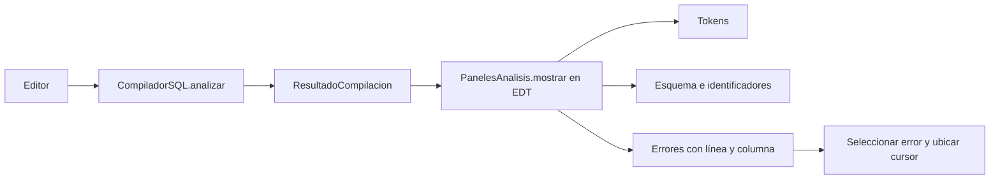

# Integrante 2: paneles de análisis y pruebas cruzadas

> **Actualización: almacenamiento permanente.** La interfaz guarda ahora tablas y filas en la carpeta del usuario `SQLStudio/datos`. Analizar y Limpiar conservan los datos. Comparar SQL y las pruebas siguen usando bases temporales. Consulta [persistencia y ejemplo entre sesiones](persistencia.md); las indicaciones anteriores sobre una base nueva en cada ejecución normal ya no aplican.

## Aporte implementado

`src/ui/PanelesAnalisis.java` presenta el resultado del compilador en cuatro
JTable de solo lectura, agrupadas en tres pestañas:

| Vista | Datos del compilador | Contenido |
| --- | --- | --- |
| Tokens | `tokens()` | Tipo, lexema, línea y columna |
| Símbolos / Esquema declarado | `catalogo()` | Tabla o columna, nombre, ámbito y tipo |
| Símbolos / Identificadores léxicos | `simbolosLexicos()` | ID, nombre, token, categoría, tipo, primera posición y apariciones |
| Errores | `errores().obtenerTodos()` | Fase, código, mensaje, lexema, línea y columna |

Se conservó la implementación existente y la refactorización local de
`mostrar`; se agregaron nombres accesibles para las tablas, acceso a la tabla
léxica para verificar el contrato y contadores en ambas vistas de símbolos.

`mostrar(ResultadoCompilacion)` primero limpia las cuatro tablas y después
carga el resultado nuevo. `mostrar(null)` deja todo vacío. Un identificador
observado por el scanner puede existir sin estar declarado en el catálogo.
Dos columnas llamadas `id` mantienen el ámbito y tipo de su propia tabla.
Los errores seleccionados navegan a su posición original incluso después
de ordenar la tabla. La posición se traduce de fila visible a fila del modelo.

La ventana y los botones ya están conectados mediante `ControladorGUI`.
El análisis se realiza en `SwingWorker` y sus resultados se presentan desde
`done()`, en el hilo de eventos de Swing. El integrante 2 consume esos datos;
no vuelve a implementar los analizadores ni los ejecutores DDL/DML.



## Archivos de esta entrega

- `src/ui/PanelesAnalisis.java`: mejoras sobre los paneles existentes.
- `tests/PruebaIntegrante2.java`: 35 comprobaciones del contrato y pruebas cruzadas.
- `tests/demo_fase2_referencia.sql`: SQL escrito independientemente del traductor,
  equivalente a `demo_fase2_valido.sql` y ejecutado en otra base vacía.
- `gui.ps1` y `gui.sh`: incorporan la nueva suite a la verificación completa.
- Este documento: explicación, ensayo, resultados y sección para el informe.

## Cómo verificar

Desde la raíz del proyecto, en macOS:

```bash
bash gui.sh compilar
java -cp 'out:lib/*' PruebaIntegrante2
java -cp 'out:lib/*' PruebaPanelesGUI
```

En Windows, después de compilar:

```powershell
powershell -NoProfile -ExecutionPolicy Bypass -File .\gui.ps1 -Modo compilar
java -cp 'out;lib/*' PruebaIntegrante2
java -cp 'out;lib/*' PruebaPanelesGUI
```

Para verificar también la ventana completa, ejecutar `bash gui.sh pruebas`
o `VERIFICAR_FASE3.cmd` desde una sesión de escritorio. Las pruebas nuevas
no necesitan pantalla y ejecutan sus comprobaciones de Swing en el EDT.

## Ensayo de integración coordinado por el integrante 2

| Paso | Acción | Resultado que debe observarse | Responsable de comprobar |
| --- | --- | --- | --- |
| 1 | Abrir la aplicación y dejar el editor vacío | Analizar y Ejecutar deshabilitados | Integrantes 1 y 2 |
| 2 | Pegar `tests/demo_fase2_valido.sql` y Analizar | 15 sentencias válidas, 0 errores; clientes y cinco columnas en el esquema | Integrante 2 |
| 3 | Inspeccionar Tokens e Identificadores léxicos | Lexemas, posiciones y apariciones; identificadores observados distintos del esquema final | Integrante 2 |
| 4 | Ejecutar el ejemplo | 15 resultados, consultas y cantidades afectadas | Integrantes 3 y 4 |
| 5 | Pegar `tests/demo_fase2_referencia.sql` en SQL de referencia y Comparar | Comparación aprobada sobre bases independientes | Los cuatro |
| 6 | Modificar el texto fuente | Ejecutar queda deshabilitado hasta volver a analizar | Integrantes 1 y 2 |
| 7 | Pegar `tests/demo_fase2_errores.sql` y Analizar | Ocho errores; ejecución bloqueada; seleccionar un error ubica el cursor | Integrantes 1 y 2 |
| 8 | Quitar por separado un punto y coma, coma o paréntesis | Error con posición y ejecución bloqueada | Integrante 2 |
| 9 | Analizar dos veces scripts distintos y pulsar Limpiar | Sin catálogo, identificadores ni errores del análisis anterior | Integrante 2 |
| 10 | Ejecutar el caso de fallo SQL de `PruebaInterfaz` | Error visible, detención del script y controles recuperados | Integrantes 1, 3 y 4 |
| 11 | Repetir el ejemplo válido | Sin conflictos por tablas de la demostración anterior | Los cuatro |

La comparación ignora el orden de las filas y conserva su multiplicidad.
Cada análisis empieza con catálogo vacío y cada ejecución con una base nueva.
El catálogo final es una salida del análisis, no el estado inicial de JDBC.

## Validación realizada el 25 de octubre de 2026

Compilación con JDK 25, destino `--release 21`, UTF-8, `-Xlint:all -Werror`.
Las ocho suites de fases 1 y 2 aprobaron 496 comprobaciones. También pasaron
las 69 comprobaciones de ejecución SQL, las 28 de paneles GUI y las 35 nuevas
del integrante 2: 628 comprobaciones aprobadas en once suites sin ventana.

La suite `PruebaInterfaz`, que crea una ventana nativa, abortó al arrancar en
el entorno de ejecución de esta sesión. No se marca como aprobada: queda
pendiente repetirla desde el escritorio y realizar el ensayo visual con el equipo.
No se simuló un fallo de conexión; el ensayo incluye el fallo del motor SQL
que ya prepara `PruebaInterfaz`.

No se ha publicado un PR ni se ha realizado la revisión de otro integrante.
Antes de integrar, separar los cambios de esta entrega de los cambios locales
previos, usar la rama acordada `feature/fase3-paneles` y obtener la revisión.

## Sección breve para el informe

El módulo de paneles de análisis presenta los resultados léxicos, sintácticos
y semánticos del compilador SQL mediante tablas Swing de solo lectura.
Distingue los identificadores encontrados del esquema declarado y muestra
los errores con fase, código, mensaje y posición. Cada análisis sustituye el
anterior para evitar resultados obsoletos. La integración permite ubicar el
cursor al seleccionar un diagnóstico. Se añadieron pruebas del contrato entre
el compilador y las tablas, limpieza, reanálisis, ámbitos, posiciones y rechazo
de scripts incompletos. Las pruebas cruzadas comparan el ejemplo de fase 2
con SQL independiente, verificando consultas y estado final sobre bases nuevas.
La verificación automatizada sin ventana aprobó; el ensayo de escritorio y la
revisión por otro integrante se registran como pasos pendientes de integración.

## Explicación oral sugerida

«Mi parte muestra lo que produce el compilador. La pestaña Tokens permite
inspeccionar cada lexema y su posición. Símbolos distingue los nombres
observados de las tablas y columnas declaradas; una columna pertenece al
ámbito de su tabla. Errores reúne los diagnósticos y permite ir a la línea y
columna del problema. Antes de mostrar otro análisis limpio los modelos para
no conservar datos anteriores. También preparé las pruebas cruzadas con un
SQL equivalente independiente y coordiné el guion de demostración con los
módulos de interfaz y ejecución».
