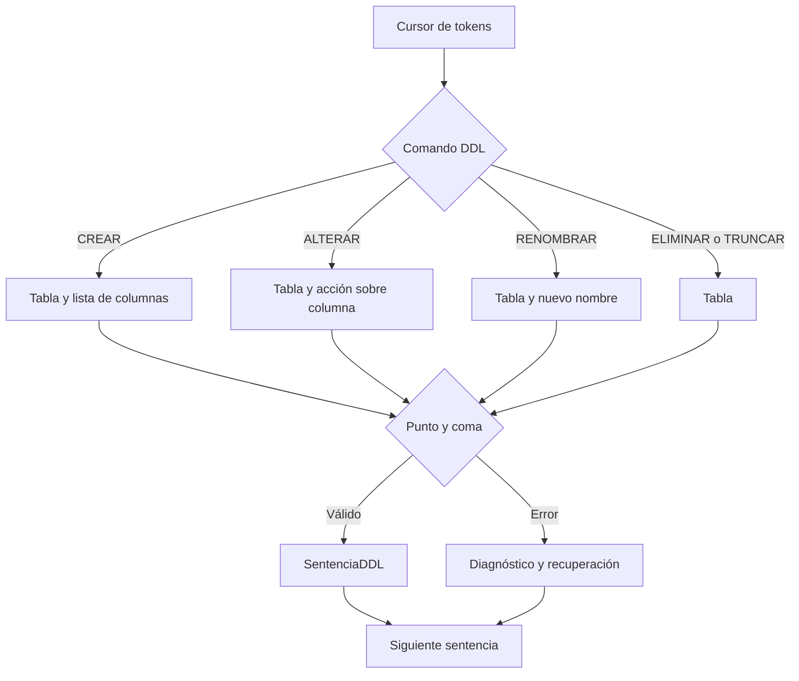

# Analizador sintáctico DDL — Fase 2

Este módulo toma la lista de tokens producida por `ScannerSQL` y construye
sentencias DDL inmutables. La validación de nombres existentes, duplicados,
ámbitos y efectos sobre el esquema corresponde al análisis semántico.

## Gramática implementada

```text
sentencia       ::= crear | alterar | eliminar | truncar | renombrar
crear           ::= CREAR TABLA identificador '(' columna (',' columna)* ')'
alterar         ::= ALTERAR TABLA identificador (AGREGAR columna | MODIFICAR columna | QUITAR identificador)
eliminar        ::= ELIMINAR TABLA identificador
truncar         ::= TRUNCAR TABLA identificador
renombrar       ::= RENOMBRAR TABLA identificador A identificador
columna         ::= identificador tipo_dato
tipo_dato       ::= ENTERO | TEXTO | FECHA | DECIMAL | BOOLEANO
programa        ::= (sentencia ';')* EOF
```

Las formas de ALTERAR y RENOMBRAR son completas. AGREGAR, MODIFICAR, QUITAR
y A se reconocen como palabras de contexto por el parser a partir de
IDENTIFICADOR, sin alterar el comportamiento léxico de fase 1.
Cada operación se representa en SentenciaDDL junto con sus columnas o nuevo
nombre y posiciones. El analizador semántico aplica la operación al catálogo
solo cuando sus nombres y tipos son válidos.

## API

```java
ScannerSQL scanner = new ScannerSQL();
scanner.analizar(entrada);
ResultadoSintacticoDDL resultado = new AnalizadorSintacticoDDL()
        .analizar(scanner.getTokens());

resultado.getSentencias(); // solo sentencias sintácticamente válidas
resultado.getErrores();    // fase, código, mensaje, lexema, línea y columna
```

`CursorTokens` protege la lista de entrada, permite mirar sin consumir y
recupera hasta `;` o `EOF`. Cuando una sentencia falla, el analizador la
descarta y puede continuar con la siguiente para reportar más de un error.

## Pruebas

Desde la raíz del proyecto:

```sh
javac --release 21 -encoding UTF-8 -Xlint:all -Werror -d out \
  src/lexer/*.java src/parser/*.java tests/PruebaParserDDL.java
java -cp out PruebaParserDDL
```

La prueba aislada cubre el cursor, los cinco comandos DDL, columnas, tipos de
datos y recuperación. PruebaFase2 añade variantes de ALTERAR y RENOMBRAR,
posiciones, errores de cada comando y conservación del estado ante DDL inválido.

## Recorrido del parser



Vea [fase2.md](fase2.md) para el contrato completo DDL/DML, errores y semántica.
