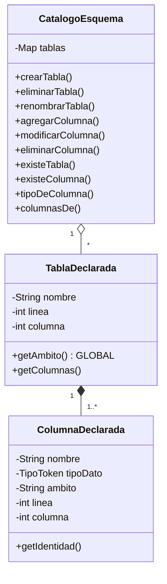
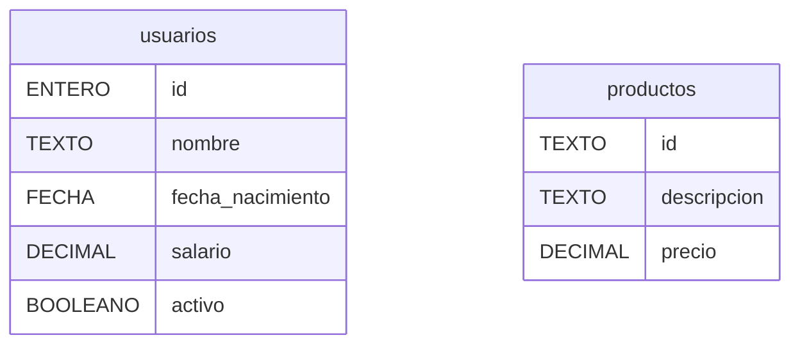
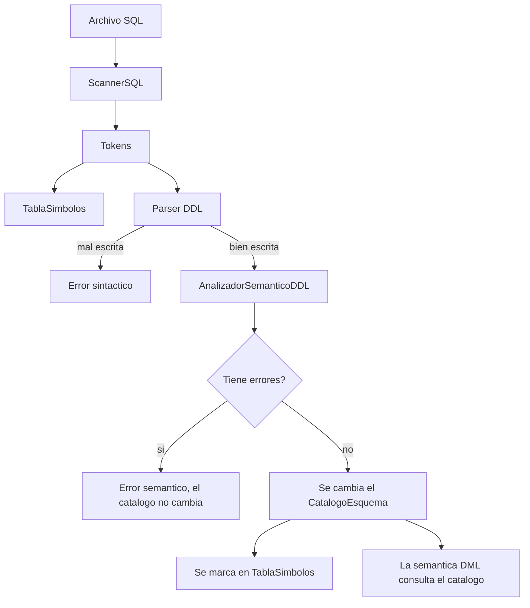

# Simbolos y semantica DDL (Fase 2)

Modulo de la Persona 3. Esta en los paquetes `symbol_table` (el catalogo) y
`semantic` (el analizador). Usa los tokens del scanner y las sentencias del
parser DDL de la Persona 1.

## 1. Que hace

El parser DDL solo revisa que las sentencias esten bien escritas. Por ejemplo
acepta `CREAR TABLA usuarios (...)` dos veces o `ELIMINAR TABLA pedidos` aunque
pedidos nunca se haya creado. Este modulo revisa que tengan sentido:

- Guarda un catalogo con las tablas que existen, sus columnas, el tipo de cada
  columna y su ambito.
- Revisa cada sentencia DDL en orden contra el catalogo y solo si esta bien
  hace el cambio.
- Deja consultas del catalogo para que la semantica DML (Persona 4) pueda
  revisar tablas, columnas y tipos.
- Le pone categoria y tipo a los nombres de la tabla de simbolos de la fase 1
  cuando quedan bien declarados.

No se guardan filas ni se ejecuta nada, por eso TRUNCAR solo revisa que la tabla
exista y deja el esquema igual.

## 2. Archivos

| Archivo | Para que |
|---|---|
| `src/symbol_table/CatalogoEsquema.java` | El catalogo: crear, eliminar, renombrar y las consultas |
| `src/symbol_table/TablaDeclarada.java` | Una tabla con sus columnas en orden |
| `src/symbol_table/ColumnaDeclarada.java` | Una columna con su tipo y su ambito |
| `src/symbol_table/TablaSimbolos.java` | La de la fase 1, se le agrego `marcarDeclarado` |
| `src/semantic/AnalizadorSemanticoDDL.java` | Las reglas de CREAR, ALTERAR, ELIMINAR, TRUNCAR y RENOMBRAR |
| `src/semantic/ErrorSemantico.java` | El error semantico |
| `tests/PruebaSemanticaDDL.java` | Pruebas (70) |
| `tests/demo_fase2.sql` | Script de demostracion con casos de los 4 |

## 3. Como funciona

### Nombres que vio el scanner vs tablas declaradas

La tabla de simbolos de la fase 1 guarda todos los identificadores que salen en
el archivo, aunque la sentencia este mala. El catalogo solo guarda lo que la
semantica acepto. Por eso en el script de demostracion `pedidos` sale en la
tabla de simbolos pero no en el catalogo (su CREAR tenia una columna repetida),
y en la tabla de simbolos se queda como DESCONOCIDA.

### Ambito

Las tablas estan en el ambito GLOBAL y cada columna esta en el ambito de su
tabla. Asi `usuarios.id` y `productos.id` son dos columnas distintas y cada una
tiene su tipo. Lo de `tabla.columna` es solo para mostrarlo y para los mensajes,
no se agrego el punto al lenguaje.

Igual que en la fase 1, los nombres se comparan en mayusculas (`usuarios` y
`USUARIOS` son la misma tabla).

Las columnas se guardan en el orden en que se declararon porque INSERTAR
necesita ese orden para comparar los valores.

### Sin cambios a medias

Primero se revisa toda la sentencia y se juntan todos los errores. Solo si no
hubo ninguno se cambia el catalogo. Entonces un CREAR TABLA con una columna
repetida no deja la tabla creada a medias.

### En orden

El catalogo empieza vacio y va cambiando con cada sentencia valida. Despues de
`ELIMINAR TABLA temporal` ya no se puede usar temporal.

## 4. Diagramas

### Tabla - columnas



Asi queda el esquema despues de la parte de la Persona 3 en el script de
demostracion. Las dos `id` son columnas distintas con tipo distinto:



### Recorrido



## 5. Reglas

| Sentencia | Que se revisa | Que cambia |
|---|---|---|
| CREAR TABLA | que la tabla no exista (SEM-101) y que no se repitan columnas (SEM-102) | se crea la tabla con sus columnas |
| ELIMINAR TABLA | que exista (SEM-103) | se quita la tabla con sus columnas |
| TRUNCAR TABLA | que exista (SEM-103) | nada |
| ALTERAR TABLA AGREGAR | que exista la tabla (SEM-103) y que la columna sea nueva (SEM-102) | agrega la columna al final |
| ALTERAR TABLA MODIFICAR | que exista la tabla (SEM-103) y la columna (SEM-104) | cambia el tipo conservando nombre, posicion y orden |
| ALTERAR TABLA QUITAR | que exista la tabla (SEM-103) y la columna (SEM-104), y que quede al menos una columna (SEM-105) | retira la columna |
| RENOMBRAR TABLA | que exista la tabla (SEM-103) y que el nombre nuevo este libre (SEM-101) | cambia el nombre y los ambitos, conservando el orden de tablas |

Estas operaciones se aplican desde `analizarSentencia` usando la representacion
completa del parser. Tambien se conserva la API publica para llamadas individuales:

- `renombrarTabla`: la tabla debe existir (SEM-103) y el nombre nuevo no (SEM-101).
  Las columnas se quedan igual pero cambian de ambito.
- `agregarColumna`: la tabla debe existir (SEM-103) y no tener ya esa columna (SEM-102).
- `modificarColumna`: la tabla debe existir (SEM-103) y contener la columna (SEM-104).
- `eliminarColumna`: la tabla debe existir (SEM-103), tener la columna (SEM-104)
  y no quedarse sin columnas (SEM-105).

## 6. Errores

Cada error tiene fase (SEMANTICA), codigo, mensaje, elemento, linea y columna,
igual que `ErrorSintactico`. Si el error es de la tabla se usa la posicion de la
sentencia y si es de una columna la posicion de esa columna.

| Codigo | Cuando sale |
|---|---|
| SEM-101 | ya existe una tabla con ese nombre |
| SEM-102 | columna repetida |
| SEM-103 | la tabla no existe |
| SEM-104 | la columna no existe en esa tabla |
| SEM-105 | la tabla se quedaria sin columnas |
| SEM-106 | representacion DDL incompleta o contradictoria; no se modifica el catalogo |

Ejemplo:

```text
[SEMANTICA][SEM-102] La columna se declara mas de una vez (elemento: "pedidos.id", L:44 C:5)
```

La API de este modulo conserva sus codigos SEM-1xx y `ErrorSemantico`. El flujo
integrado de `Main` devuelve la tabla de diagnosticos uniforme documentada en
[fase2.md](fase2.md), con los codigos SEM-001 a SEM-009.

## 7. Como se usa

### Uso de la API del modulo

```java
TablaSimbolos tabla = new TablaSimbolos();
tabla.registrarTodos(tokens);

CatalogoEsquema catalogo = new CatalogoEsquema();   //el mismo para DDL y DML
AnalizadorSemanticoDDL semanticaDDL = new AnalizadorSemanticoDDL(catalogo, tabla);

//por cada sentencia que paso la sintaxis, en el orden del archivo:
List<ErrorSemantico> errores = semanticaDDL.analizarSentencia(sentencia);
//las DML van a la semantica de la Persona 4 con el mismo catalogo

catalogo.imprimir();
tabla.imprimir();
```

Si solo hay DDL tambien se puede usar `analizar(lista)`. `getErrores()` devuelve
todos los errores que van saliendo, sin duplicar los de operaciones llamadas
desde `analizarSentencia`. Para la demostracion completa, `Main` utiliza
`CompiladorSQL` y su catalogo integrado, como se explica en [fase2.md](fase2.md).

### Consultas para la Persona 4

Todas ignoran mayusculas y no truenan si les llega null o un nombre que no existe.

- `existeTabla(tabla)`
- `existeColumna(tabla, columna)`: busca la columna dentro de esa tabla
- `buscarColumna(tabla, columna)`: la columna o null
- `tipoDeColumna(tabla, columna)`: `TIPO_ENTERO`, `TIPO_TEXTO`, etc. o null
- `columnasDe(tabla)`: las columnas en orden, vacia si la tabla no existe

Ejemplo para un INSERTAR:

```java
List<ColumnaDeclarada> columnas = catalogo.columnasDe("usuarios");
if (!catalogo.existeTabla("usuarios")) {
    //tabla no existe
} else if (valores.size() != columnas.size()) {
    //cantidad de valores incorrecta
} else {
    for (int i = 0; i < columnas.size(); i++) {
        TipoToken esperado = columnas.get(i).getTipoDato();
        //comparar con el valor i
    }
}
```

### Tabla de simbolos

`marcarDeclarado(nombre, categoria, tipo)` lo llama el analizador cuando algo se
declara bien. El nombre pasa de DESCONOCIDA a TABLA, o a COLUMNA con su tipo. Si
la misma columna esta en varias tablas con tipos distintos queda VARIOS (el
detalle de cada tabla esta en el catalogo). Lo que nunca se declaro bien sigue
DESCONOCIDA.

## 8. Formas completas de ALTERAR y RENOMBRAR

El parser construye el nombre de tabla, la operacion, la columna y su tipo, o
el nombre nuevo. La gramatica acordada e implementada es:

```text
renombrar ::= RENOMBRAR TABLA identificador A identificador
alterar   ::= ALTERAR TABLA identificador AGREGAR identificador tipo_dato
            | ALTERAR TABLA identificador MODIFICAR identificador tipo_dato
            | ALTERAR TABLA identificador QUITAR identificador
```

Cada sentencia termina con `;`. AGREGAR, MODIFICAR, QUITAR y A se reconocen
por contexto en el parser. Las formas simples `ALTERAR TABLA t;` y
`RENOMBRAR TABLA t;` son errores sintacticos. Si una llamada directa entrega
un AST incompleto, la API semantica devuelve SEM-106 y conserva el catalogo.

## 9. Pruebas

```powershell
powershell -NoProfile -ExecutionPolicy Bypass -File .\demo.ps1 -Modo pruebas
```

El instructivo compila todos los paquetes con `--release 21 -Xlint:all -Werror`
y ejecuta las suites, incluida `PruebaSemanticaDDL`: 70 pruebas, 0 fallidas.
Prueban crear tablas, la misma columna en dos tablas,
tablas y columnas repetidas, que no queden cambios a medias, ELIMINAR, TRUNCAR,
ALTERAR y RENOMBRAR completos, renombrar/agregar/modificar/eliminar columna,
AST incompletos, orden de tablas y posiciones originales, las consultas para DML,
el formato de los errores, un script pasado por el scanner y el parser de verdad
y la clasificacion de la tabla de simbolos. Al final imprime un ejemplo del
catalogo. Si algo falla termina con codigo 1.

## 10. Script de demostracion

El dispatcher integrado selecciona DDL o DML segun la primera palabra y
continua despues de errores. Para la demostracion actual use
`tests/demo_fase2_valido.sql` y `tests/demo_fase2_errores.sql`, siguiendo
[el instructivo de demostracion](instructivo_demostracion.md).

`tests/demo_fase2.sql` conserva casos del equipo agrupados por contribucion.
La salida integrada utiliza los codigos de `TablaErrores`; las pruebas de la API
aislada DDL verifican los codigos SEM-1xx descritos en este documento.
